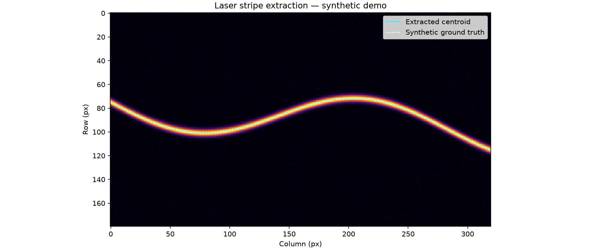

# 激光线扫相机：条纹中心提取原型

这是从零实现的最小数值原型，默认运行确定性合成样例。

## 安装与运行

需要 Python 3.11+。

```sh
python -m venv .venv
source .venv/bin/activate
pip install -r requirements.txt
python src/line_scan.py --threshold 0.2 --output artifacts
```

## 自有数据

二维灰度 NumPy `.npy` 文件；输出 stripe.csv（列号、行中心、有效标记）。采用逐列背景扣除与阈值质心，无三维标定或相机 SDK。

```sh
python src/line_scan.py --input your-data.npy --threshold 0.2 --output artifacts
```

## 实际运行结果

下面是当前代码生成的合成样例结果图，不是设备实测或 UI 截图。



## 文档

- [PRD](docs/PRD.md)
- [验证记录](docs/VALIDATION.md)

## 限制

尚未接入真实硬件或现场数据，未提供实时界面；生产性能和测量不确定度待验证。原有文档中的概念架构图与本原型运行结果分开保存。
